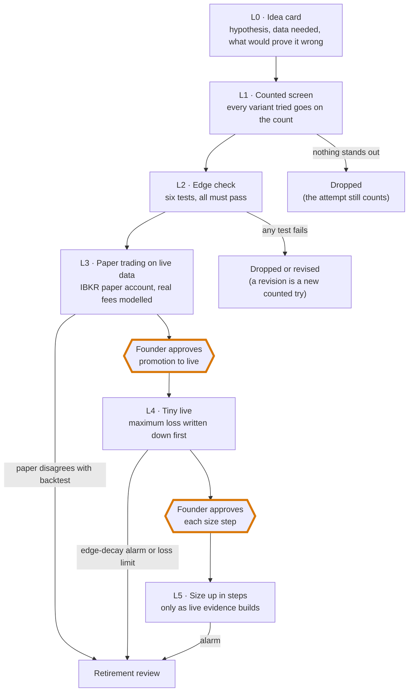
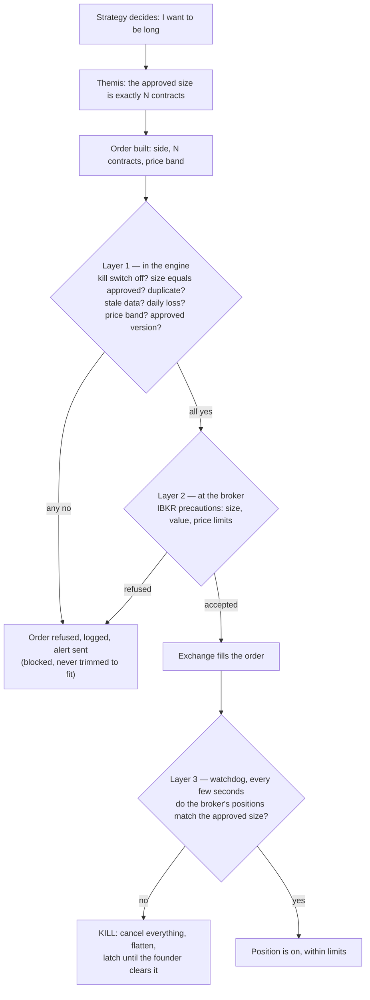
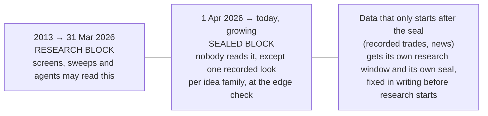
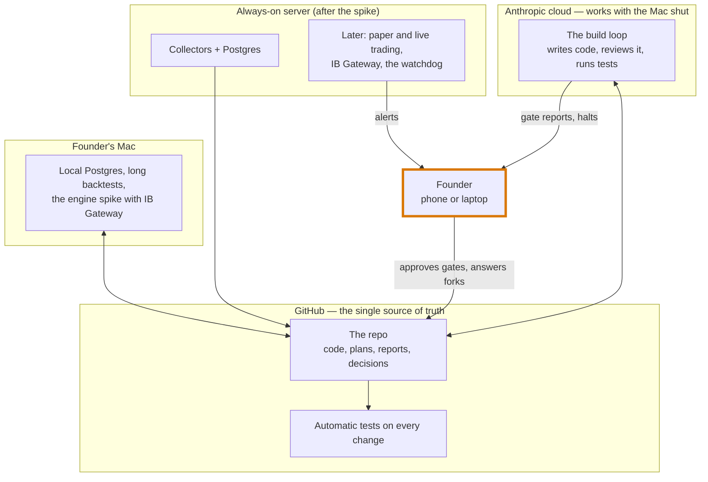
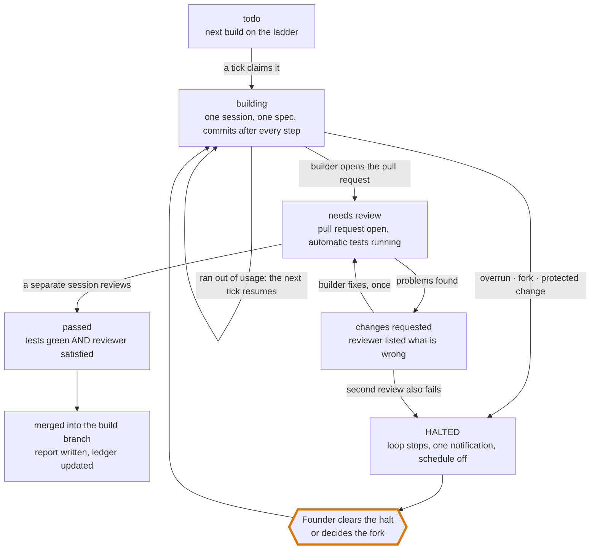
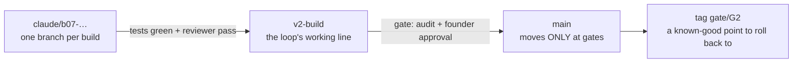
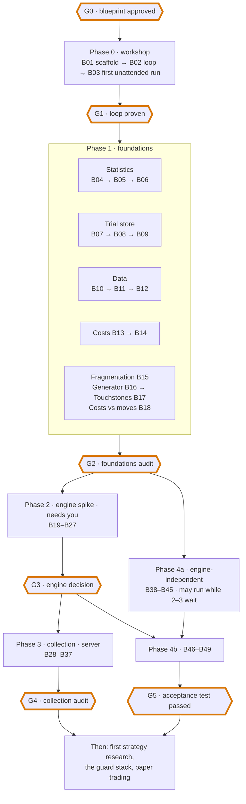

# CHRONOS v2 — BUILD BLUEPRINT (the skeleton)

**Status: DRAFT v0.1, 16 Nov 2026 (UTC). Not adopted until the founder approves gate G0.**
Companion to the master document `docs/v2/CHRONOS_V2.md`, which still wins if the two disagree (§0 there).

This file answers three questions:

1. **What is Chronos, as a system?** Part 1: line diagrams, top to bottom.
2. **How do we build it without the founder carrying messages between chats?** Part 2: the build loop, its checks, its brakes.
3. **In what order, in what size pieces?** Parts 3–7: what we reuse from v1, when each outside component enters, and the ladder of builds, each sized to one session, with a gate after each phase.

Companion files in this folder:

| File | What it is |
|---|---|
| `HANDBOOK.md` | The founder's manual: what to click, what each report means, what to do when the loop stops, which model to use, what to do when usage runs out |
| `LADDER.yaml` | The same ladder as Part 5, in a form the loop's script reads. If the two disagree, `LADDER.yaml` is what runs, and that is a bug to fix |
| `LEDGER.md` | Estimate vs actual for every build. The plan is re-sized from this, not from hope |
| `V1_CARRYOVER.md` | Every v1 file: port, adapt, reference or retire, and which build takes it |
| `BUILD_CARDS.md` | One card per build for phases 2–4 (the spike, collection, the acceptance test) |
| `specs/B01…B18` | One full spec per build for phases 0–1. A build session needs nothing but its spec and the files the spec lists |

**Words used here.** A **build** is one piece of work small enough for one session, ending in one pull request. A **tick** is one wake-up of the loop: it does one thing (build, review, fix or merge) and stops. A **gate** is a checkpoint where the loop stops and waits for the founder. The **loop** is the scheduled wake-ups plus the rules in Part 2.

---

## Part 1 — The system in lines

Read each diagram top to bottom. Solid boxes are things we build or run. **Thick orange borders are the founder.** **Dashed borders are places where an AI model is allowed to think**; everything else is ordinary deterministic code. A model's output never crosses into the order path except as a number that deterministic code has checked, sized and limited (hard rule 1, V2-D07).

### 1A. The whole machine

```mermaid
flowchart TD
  subgraph SRC["1 · THE OUTSIDE WORLD"]
    KR["Kraken spot<br/>candles and trades<br/>(signal history)"]
    IB["IBKR crypto futures<br/>quotes, funding, fees, fills<br/>(what we actually trade)"]
    NW["News, X, GDELT, Grok"]
    MC["Macro releases"]
  end

  subgraph COL["2 · COLLECTORS — always-on server (after the spike)"]
    BG["Budget guard<br/>every paid call is reserved first"]
    RC["Recorders<br/>raw files + hashes, gaps logged, never papered over"]
  end

  subgraph OCE["3 · OCEANUS — data"]
    VC["Validate and clean<br/>never interpolate, report every dropped row"]
    ST["Store<br/>Parquet + DuckDB for prices and trades<br/>Postgres for events<br/>every snapshot has a hash"]
    DOOR["THE DATA DOOR<br/>the only way research reads data<br/>refuses anything from 1 Apr 2026 onward<br/>returns data + a footprint of what was read"]
  end

  subgraph RES["4 · RESEARCH — ideas become counted trials"]
    PRO["Prometheus<br/>AI research agents write idea cards"]
    FND["Founder ideas"]
    KRO["Kronos candle model<br/>a number fed to rules, no authority"]
    REG["Hypothesis registry<br/>claim, data needed, falsifier<br/>written BEFORE testing"]
    SCR["Screening<br/>fast sweeps<br/>EVERY variant tried is counted"]
  end

  MNE[("5 · MNEMOSYNE — the trial store<br/>every trial, its returns, its trades,<br/>its data footprint, its code version<br/>append-only: nothing edited, nothing deleted")]

  subgraph MOI["6 · MOIRAI — is the idea real?"]
    EC["Edge check<br/>enough data? · beats the count of tries? ·<br/>survives 2x costs? · beats random entries? ·<br/>not a lone lucky setting? · one look at sealed data<br/>(the verdict is stored in Mnemosyne)"]
  end

  VR["7 · VERSION REGISTRY<br/>baseline · candidate · paper · live · rolled back"]
  APP{{"FOUNDER APPROVAL<br/>thresholds · risk limits · go-live"}}

  subgraph TRD["8 · TRADING — deterministic only"]
    THE["Themis — sizing<br/>drawdown budget sets the size"]
    NAU["Strategy node on NautilusTrader<br/>same code in backtest, paper and live"]
    N1["Nemesis layer 1<br/>risk checks inside the engine"]
    GW["IB Gateway"]
    N2["Nemesis layer 2<br/>IBKR's own order limits"]
    EX["Exchange<br/>Coinbase nano BTC and ETH · CME micro"]
  end

  subgraph WAT["9 · WATCHING — three independent watchers"]
    N3["Nemesis layer 3 — watchdog<br/>separate user, separate connection<br/>reads the broker's own positions"]
    ALE["Aletheia — reconciliation<br/>our books vs the broker's"]
    ARG["Argus — monitoring<br/>edge-decay alarm, alerts"]
  end

  STOP["STOP<br/>no new entries · or cancel everything and flatten<br/>latched until the founder clears it"]
  PH["Founder's phone"]
  CC["10 · MOIRAI again — change check<br/>is a new version better<br/>AND profitable on its own?"]

  KR --> RC
  IB --> RC
  NW --> BG --> RC
  MC --> RC
  RC --> VC --> ST --> DOOR
  DOOR --> PRO
  DOOR --> KRO
  DOOR --> SCR
  PRO --> REG
  FND --> REG
  KRO --> REG
  REG --> SCR
  SCR --> MNE
  MNE --> EC
  DOOR -->|"one sealed look, recorded"| EC
  EC -->|"pass"| VR
  VR --> APP
  APP -->|"approved version and size"| THE
  THE --> NAU --> N1 --> GW --> N2 --> EX
  EX -->|"positions"| N3
  EX -->|"fills"| ALE
  EX -->|"results per trade"| ARG
  N3 -->|"size not as approved"| STOP
  ALE -->|"mismatch"| STOP
  ARG -->|"edge fading"| STOP
  STOP --> PH
  ARG -->|"paper and live results"| CC
  CC -.->|"improved version, or retirement"| VR

  classDef founder stroke:#d97706,stroke-width:4px;
  classDef ai stroke-dasharray: 6 4;
  class APP,FND,PH founder;
  class PRO,KRO ai;
```



What to take from it:

- **Data flows down, evidence flows into the middle, money only moves at the bottom.** Nothing in boxes 4–6 can place an order.
- **Mnemosyne (5) is the memory that keeps us honest.** If a try isn't in it, it didn't happen; if it is in it, it can't be removed.
- **Three layers can refuse or stop an order** (Nemesis 1–3), and three watchers can trigger a stop. STOP acts on the engine and on the gateway; it is latched, and only the founder clears it. The founder's approval sits between "it passed" and "it trades".

### 1B. The evidence ladder — how an idea earns money



### 1C. The order path — what stands between a bug and your money



The rule behind all three layers: **fail closed**. If a guard is down, slow or unsure, the answer is no.

### 1D. Time and the seal — what research may look at



Why it matters: a statistical test can only correct for tries it is told about. The sealed block catches what nobody counted. Reading it twice for the same idea is refused by the database, not by good intentions (V2-D34, V2-D38, V2-D46).

### 1E. Where things run



### 1F. Where the code lives

```
chronos/                         (this repo, public)
├── CLAUDE.md                    rules every session reads
├── docs/v2/
│   ├── CHRONOS_V2.md            MASTER DOCUMENT — wins every disagreement
│   ├── BUILD_NOTES.md           traps, by component
│   ├── COMPONENTS.md            where every outside piece comes from
│   ├── CODEBASE.md              what every file is
│   ├── CHANGELOG.md             dated work log
│   └── build/                   ← THIS FOLDER: blueprint, handbook, ladder, specs, reports, gates
├── v2/                          ← ALL NEW CODE (its own uv project, Python 3.14, V2-D45)
│   ├── pyproject.toml  uv.lock
│   ├── src/chronos2/
│   │   ├── core/                time, ids, config hashing, money types
│   │   ├── stats/               ported statistics + rank counters
│   │   ├── mnemosyne/           trial store (Postgres)
│   │   ├── oceanus/             data: schema, store, validate, clean, the door
│   │   ├── costs/               venue fees, cost components, stress runs
│   │   ├── moirai/              validation: fragmentation warning, later edge and change checks
│   │   └── fixtures/            synthetic worlds, touchstones
│   ├── migrations/              database schema, numbered SQL files
│   ├── tests/                   mirrors src/, plus known_answers/
│   └── tools/loop/              the loop's deterministic "what's next" script
├── .claude/                     agent definitions and commands for the loop
├── .github/workflows/           v1 tests (untouched) + v2 tests and guards
├── src/  tests/                 v1, FROZEN — never edited (V2-D29)
└── docs/v1-archive/             v1 documents, frozen
```

---

## Part 2 — The build system

### 2.1 What was wrong, and the replacement

**Before:** project chat writes a prompt → the founder pastes it into Claude Code → pastes the output back → the chat judges it → repeat. The founder is the message bus, the plan lives in chat memory, and one "session" has no size limit.

**After:** the instructions live in the repo as spec files. A scheduled session reads the next spec, builds it, and opens a pull request. A second, separate session reviews it against the spec. Automatic tests judge both. The founder is asked only for things that are his: gates, forks, protected changes.



### 2.2 The four roles

| Role | Who | May do | May never do |
|---|---|---|---|
| **Builder** | A fresh AI session, model named in the spec | Write code and tests for exactly one build, inside the files its spec lists | Edit v1. Touch tests from earlier builds. Change a spec's pass/fail checks. Merge anything |
| **Reviewer** | A different fresh session (it has never seen the builder's reasoning). Always Opus | Run the checks itself, read the diff against the spec, write a verdict, merge a passing build into the build branch | Change code or tests. Review its own work |
| **Tests (CI)** | GitHub, automatic, on every pull request | Decide pass or fail with no opinion involved | — |
| **Founder** | You | Approve gates. Decide forks and protected changes. Clear halts. Take over any build by hand | — (you can do anything; the system just never *requires* more than this) |

At gates a fifth role appears: the **auditor**, a session that has seen neither the building nor the reviewing, told to re-derive the important results from the specs alone and to try to break the tests (V2-D25 rule 3).

Why the builder and reviewer are separate sessions and not "one smart agent": a session that wrote the code believes its own story about it. Every tick of the loop starts a fresh session with no memory of the last one [Certain — Claude Code scheduled-task docs, read 16 Nov], so independence comes free.

### 2.3 What a tick does

One scheduled task wakes the loop (at most hourly; that is the platform's minimum [Certain — same docs]). Each wake-up:

1. Runs a small deterministic script (`v2/tools/loop/next_action.py`). **Code, not an AI, decides what is next**, by reading `LADDER.yaml`, the branches and each build's status file. Next is the first build on the ladder whose prerequisites are done; one build is finished (built, reviewed, merged) before another starts.
2. Does exactly one action: start a build · resume a build · review · fix · merge · run a gate audit · or nothing.
3. Commits its progress and stops.

If the script says "waiting on the founder" or "halted", the loop sends one notification and **switches its own schedule off**, so it doesn't burn usage waking up to do nothing. Turning it back on is one sentence to Claude ("resume the loop") or one switch in the app.

**Running out of usage mid-build is normal, not a failure.** Every spec is an ordered checklist, and the builder commits after each step. The next tick reads the spec, the checklist and the diff, and carries on. Nothing depends on a session's memory.

**Taking over by hand.** In any Claude Code session (cloud, desktop app or the Mac terminal) the same commands work: `/tick` does whatever is next, `/status` says where things stand in plain words. A manual session and the loop can't collide: the first thing either does is claim the build in its status file, and a claim is respected for three hours.

### 2.4 Branches: why `main` can't rot



- Builds merge into **`v2-build`** on their own.
- **`main` moves only when you approve a gate.** If something turns out wrong three builds later, `main` and the last gate tag are untouched.
- Unattended sessions are told never to merge into `main`, and the platform itself treats a scheduled prompt as "not the user's live approval" [Certain — same docs]. This is a guard rail, not a wall: the agent acts with your GitHub identity, so GitHub can't tell you apart. A second GitHub identity for the agent makes it a wall; that hardening is scheduled before anything can trade (see Part 7), where it matters.

### 2.5 The five layers of checking

| # | Layer | When | What it catches |
|---|---|---|---|
| 0 | **Spec** | Before any code | The pass/fail checks and the known answers are written first, by a session that isn't doing the build. The builder can't move the goalposts: specs are frozen once a build starts |
| 1 | **Tests on every pull request** | Every build | Wrong numbers (known-answer tests). Edits to v1 (compared against `v1-final`: must be empty). Edits outside the files the spec lists. Deleted or weakened earlier tests. Protected values changed. Timezone not UTC |
| 2 | **Independent reviewer** | Every build | Code that passes tests but doesn't do what the spec says. Tests that can't fail. Hard-rule violations (CLAUDE.md 1–10). It must run the checks itself and break one thing on purpose to see a test go red |
| 3 | **Gate audit** | End of each phase | Blind re-derivation of key numbers. **Sabotage run:** the code is mutated automatically, and every mutation the tests don't notice is listed and must be killed or explained. End-to-end run. Docs match reality. Estimates vs actuals |
| 4 | **Founder** | Gates only | Whether the direction is still right. Each gate report has "three things you can check yourself" in plain language |

Two rules sit across all layers:

- **Known answers come from outside the builder's head.** From the papers, from v1's own passing tests, or from a second library (`arch`, `quantstats`, `ml4t-diagnostic`). "The model remembers the formula" is not a source (hard rule 5).
- **Every check must be able to fail.** A check that has never been seen red proves nothing. Layer 2 and layer 3 both exist to see it red.

### 2.6 Brakes: when the loop stops itself

A build is **halted** (status `halted`, a reason file with the options, one notification) when any of these happens. A halted build blocks only the builds that need it; the loop carries on with any other chain that is runnable, and switches its schedule off when nothing is. The two triggers marked *global* stop everything.

| Trigger | Why |
|---|---|
| A build fails review twice | Two tries means the spec or the approach is wrong, not the typing |
| A build overruns its size budget (2.7) | The estimate was wrong. Stop, split it, renumber, record it |
| Tests go red on `v2-build` *(global)* | Something merged that shouldn't have |
| The builder hits a fork between non-equivalent options, or a conflict with the master doc | Hard rule 9: only the founder decides |
| A change touches a protected value (validation thresholds, risk limits, promotion to live, a seal date) | Hard rule 7: show the diff and wait |
| The v1 guard trips *(global)* | v1 is frozen |

A halt is cleared by the founder, usually with one sentence in a session ("split it as proposed", "take option b"). Nothing proceeds around a halt.

### 2.7 What "one session" means here

The past problem (a plan of 5 sessions taking 12–13) has two causes this blueprint attacks directly: builds with no size limit, and plans never corrected against reality.

**Size classes.** Every build is S or M. There is no L: a build that would be L is split before it starts.

| | S | M |
|---|---|---|
| New or ported code | ≤ 150 lines | ≤ 400 lines |
| Tests | ≤ 300 lines | ≤ 600 lines |
| Files touched | ≤ 8 | ≤ 14 |
| New outside libraries | 0–1 | ≤ 2 |
| Reading list (spec + sources) | ≤ 800 lines | ≤ 1,500 lines |
| Build ticks allowed | 2 | 3 |
| Ideas | one | one |

These numbers are my estimates of what fits in one unhurried session with room to test [Guessing — to be measured]. That is why:

- **`LEDGER.md` records estimate vs actual for every build** (ticks, lines, review rounds).
- **Gate G1 and gate G2 re-size the rest of the ladder from those numbers.** If M builds keep needing 4 ticks, M shrinks.
- **I can't promise a count of sessions** [Certain]. What the system guarantees instead: an overrun is caught at the first build it happens in, costs one halt, and updates every later estimate.

Honest count as planned: **49 builds and 6 gates to the end of the acceptance test** (master doc §9 steps 2–5). Of those, 18 builds are fully specified today; the rest have cards (`BUILD_CARDS.md`) and get full specs when their phase opens, because the engine spike can still change what they should say.

### 2.8 Which model does what — decided by the spec, not by you

| Work | Model | Why |
|---|---|---|
| Reviews, gate audits | **Opus**, always | The check must be at least as strong as the work |
| Any build that touches code or tests under `v2/` | **Opus** | It affects results |
| Docs-only or CI-wiring builds, report formatting | **Sonnet** | No effect on results; the reviewer is still Opus |
| Planning, architecture, spec writing, red-teaming a plan | **Fable while the plan allowance lasts, else Opus** | Highest-stakes thinking; rare |
| Anything in the loop | **Never Fable, never a local or third-party model** | On the Pro plan Fable is billed separately as usage credits [Certain — Anthropic support article, read 16 Nov]; an unattended loop must not be able to spend money |

Every spec carries a `model:` line. The loop obeys it. When you run a build by hand, `/tick` first says "this build wants Opus; you are on X" and stops until it matches. You never have to judge it.

### 2.9 Money

Founder's cap for month one: **US$100 for everything** (16 Nov). Today's spend is Claude Pro, $20.

| Item | Monthly | Status |
|---|---|---|
| Claude Pro | $20 | Have it |
| Usage-credit cap in Claude settings | set to **$0–20** | So nothing can surprise you. Raise it on purpose, never by accident |
| ChatGPT Plus, for a second-opinion reviewer from a different AI family at gates | $20 | **Decide at G1**, with a measured comparison at G2 of what it catches that the Claude reviewer didn't |
| Claude Max instead of Pro (5× the allowance) | $100 | **Decide after B03**, from measured builds-per-week on Pro. It would use the whole cap by itself |
| Server, data, other APIs | $0 | Nothing until the spike is done (V2-D30) |

The decision rule is written in `HANDBOOK.md` §7 so it isn't made in the moment.

---

## Part 3 — What we keep from v1

The full file-by-file ledger is `V1_CARRYOVER.md`. Summary of the re-audit (16 Nov, all of `src/`, `tests/`, the root scripts; 7,341 lines of code, 5,873 of tests):

| v1 asset | Lines (code / tests) | Old plan | **After re-audit** | Build |
|---|---|---|---|---|
| Statistics core `moirai/statistics.py` | 270 / 407 | Port | Port, unchanged maths | B04 |
| Math probe `chronos_math_probe.py` (28 checks) | 340 | Port | Port as tests | B05 |
| Trial ontology in `run.py` (hypothesis, SEARCH/VERIFICATION, honest N) | ~120 of 346 / 143 | Port | Port the ontology; leave the engine glue behind | B08 |
| **Data layer: bar schema, Parquet store, snapshot hash** `oceanus/model.py`, `store.py` | 248 / 213 | Reference | **Port** (proposal P-16) | B10 |
| **Data layer: validate, clean** `oceanus/validate.py`, `clean.py` | 261 / 213 | Reference | **Port** (P-16) | B11 |
| Data door `oceanus/access.py` + `seal.py` | 337 / 403 | Reference | Adapt: keep the single-door pattern and its tests' shape; the seal becomes date-based with a look limit | B12, B41 |
| Cost model `hephaestus/costs.py` | 140 / 130 | Reference | Reference: keep "no path around costs"; v2 costs are per-contract dollars, not basis points | B13 |
| Slippage method `measure_slippage.py` | 200 | Reference | Port the method onto a generic trade tape | B14 |
| Fragmentation screen in `stages/eligibility.py` | ~110 of 250 | Port | Port as a pure function over the trial store | B15 |
| Synthetic generator `calibration/generator.py` | 184 / 78 | Port | Port | B16 |
| Touchstones `calibration/touchstones.py` + fixture | 575 / 72 | Port | Port the **definitions** (worlds, rules, seeds) as data; the v1 runner is gauntlet-bound and stays behind | B17, B46 |
| Hashed, versioned config idea `moirai/config.py` | 125 / 227 | Reference | Port the canonical-hash helper into `core/` | B01 |
| Trade-shuffle drawdown, round-trip rebuild `trade_shuffle.py`, `round_trips.py` | 218 | Reference | Port into sizing (drawdown is a sizing input) | B45 |
| Cadence-matched random entries `moirai/nulls.py` | 114 | — | Reference for the v2 null; the recipe differs (V2-D21) | B40 |
| Engine `hephaestus/*`, gauntlet pipeline, stages 4.1/4.5–4.8/4.10, Binance ingest, v1 scripts | ~3,700 | Retire | Retire (unchanged verdict). The engine is used once more as the comparison in the spike | — |

**Net effect of the re-audit:** about 500 more lines of tested v1 code are ported instead of rewritten (the data layer), and the touchstones' definitions are separated from their runner so they survive the engine change. Nothing in v1 is edited, ever (V2-D29).

The v1 *commitments* that carry over unchanged are listed in the master doc §6 ("Kept from v1"): honest trial counting, DSR, dependence-aware statistics, provenance for every threshold, no seed shopping, sealed holdouts, asymmetric findings stated asymmetrically.

---

## Part 4 — When each outside component enters

Nothing third-party enters the code base until the build named here, and never without the entry test passing. Versions are pinned in `v2/uv.lock`; the lock file's hash is part of every trial's code coordinate (V2-D42).

| Component | Role | Enters at | Entry test (must pass in that build) | If it fails |
|---|---|---|---|---|
| Python 3.14, numpy, scipy, pandas, pyarrow | Base | B01 | All install together; smoke tests [already run 16 Nov: pass] | Fall back to 3.13 (V2-D45) |
| psycopg 3 + PostgreSQL 16 | Trial store | B07 | Append-only attack test: 8 of 8 destructive statements refused | Halt |
| `arch` | Second opinion: Newey–West, bootstrap; later SPA/StepM/MCS | B06 (test-only) | Matches our Newey–West to 1e-10 on the fixed series | Record the difference; ours stays |
| `quantstats` | Second opinion: Sharpe, PSR; later reports | B06 (test-only) | With `periods` passed, matches ours to 1e-9 | Same |
| `ml4t-diagnostic` | Second opinion: DSR (2025 form, labelled as such) | B06 (test-only) | Difference from ours is the documented one (BUILD_NOTES §2), no other | Same |
| duckdb | Queries over Parquet | B12 | Bar counts at both ends of a half-open range | Use pandas only |
| NautilusTrader (pinned) | Engine | B19 (spike only) → adopted at G3 | The six spike criteria, master doc §9 step 3 | Re-argue the engine (V2-D04) |
| `ml4t-backtest` | Third opinion for fills | B20 (test-only) | Five fill tests; every difference explained (V2-D43) | — |
| IB Gateway + IBKR paper account | Execution | B22 | Nano contract found, subscribed, paper-traded both ways | Engine-choice problem: raise at once |
| VectorBT | Screening | B38 | The five-fix wrapper tests (BUILD_NOTES §2); 1.2.1 re-checked against the 1.2.0 findings | Hand-written vectorised screener |
| World Monitor news catalog (AGPL-3.0) | S-NEWS source list | B33 | Licence file added, notices kept (founder, 15 Nov) | — |
| Grok API, Claude API (collectors) | S-NEWS scoring | B35, only after B29 | Budget guard known-answer tests: over-budget plan → 0 calls | No paid collector runs |
| Kronos model | Shadow signal | After G5, after a baseline exists (V2-D05) | Training cutoff confirmed from the repo first | — |
| `tick`, OrderflowChart | Parked order-flow thesis | Not scheduled | — | — |

**AI models used to *build* Chronos are a separate matter** from models used *inside* Chronos, and are covered in 2.8 and the handbook. Local or third-party coding models never write code that reaches `v2-build` without passing layers 1 and 2 like anything else, and are never used for the builds marked Opus.

---

## Part 5 — The ladder

`who`: **loop** = runs unattended · **you+** = needs you present (your accounts, your Mac, or your money) · **gate** = stops for your approval.

### Phase 0 — The workshop (no trading logic)

| Build | What | Size | Model | Who | Needs |
|---|---|---|---|---|---|
| **G0** | **This blueprint approved** | — | — | gate | — |
| B01 | v2 project scaffold, automatic tests, the guards | M | Opus | loop* | G0 |
| B02 | The loop itself: ladder reader, "what's next" script, agent definitions, commands | M | Opus | loop* | B01 |
| B03 | First unattended run on a harmless build; schedule and notifications | S | Opus | you+ (10 min) | B02 |
| **G1** | **The loop is proven.** Estimates re-sized from B01–B03. Decide: second-opinion reviewer | — | Opus | gate | B03 |

\* B01–B03 are run by hand with `/tick`-style prompts, because the loop doesn't exist until B02 is merged.

### Phase 1 — Foundations (master doc §9 step 2)

| Build | What | Size | Model | Who | Needs |
|---|---|---|---|---|---|
| B04 | Statistics I: the ported core and its known-answer tests | M | Opus | loop | G1 |
| B05 | Statistics II: the 28-check probe as tests; mid-rank counters; the floating-point tie case | M | Opus | loop | B04 |
| B06 | Statistics III: cross-checks against three outside libraries | S | Opus | loop | B05 |
| B07 | Trial store I: Postgres test harness, migrations, append-only, audit | M | Opus | loop | G1 |
| B08 | Trial store II: content ids, code coordinate, hypotheses, SEARCH/VERIFICATION, honest N | M | Opus | loop | B07 |
| B09 | Trial store III: per-trial returns and trades, data footprint, compare guard, seal audit | M | Opus | loop | B08 |
| B10 | Data I: bar schema, Parquet store, snapshot hash | M | Opus | loop | B01 |
| B11 | Data II: validate and clean | M | Opus | loop | B10 |
| B12 | Data III: the data door with the seal guard and footprints; Kraken candle-file loader | M | Opus | loop | B09, B11 |
| B13 | Costs: venue fee schedules, cost components, 2× and adverse-funding stress | M | Opus | loop | B01 |
| B14 | Slippage and spread measurement method | S | Opus | loop | B13 |
| B15 | Search-fragmentation warning | M | Opus | loop | B04, B08 |
| B16 | Synthetic world generator | S | Opus | loop | B10 |
| B17 | Touchstones as pre-registered fixtures (written down, not run) | M | Opus | loop | B16, B04 |
| B18 | Costs vs typical price moves by holding time (proposal P-12) | S | Opus | loop | B12, B13 + a data file |
| **G2** | **Foundations audit.** v1-vs-v2 parity table, sabotage run, blind re-derivation, doc sync, re-size | — | Opus | gate | B04–B18 |

Three independent chains here (statistics B04→B06, trial store B07→B09, data B10→B12) mean a halt in one doesn't block the others.

### Phase 2 — The engine spike (step 3) · cards in `BUILD_CARDS.md`

| Build | What | Size | Who |
|---|---|---|---|
| B19 | Spike prep: pinned NautilusTrader, data in, the v1 test strategy re-implemented | M | loop |
| B20 | Criterion (a): match v1's engine; five fill tests on Nautilus and on ml4t-backtest | M | loop |
| B21 | Criterion (b): our cost model plugged into the engine | S | loop |
| B22 | IBKR paper hookup on the Mac; find the nano contract | S | you+ |
| B23 | Criterion (e): paper-trade nano both ways; read funding and fees; funding history for V2-D39 | M | you+ |
| B24 | Criterion (f): broker refuses an oversize order; a second connection can see and flatten | S | you+ |
| B25 | Criterion (d): two strategies, two venues, one node | S | you+ |
| B26 | Criterion (c): several days unattended, across a Monday re-login | S | you+ (calendar time) |
| B27 | Spike report | S | loop |
| **G3** | **Engine decision** (V2-D04 becomes final, or is re-argued) | — | gate |

### Phase 3 — Always-on collection (step 4) · cards in `BUILD_CARDS.md`

| Build | What | Size | Who |
|---|---|---|---|
| B28 | Server up: hardening, Postgres, backups, UTC | M | you+ (you pay and click; Claude drives) |
| B29 | Budget guard for paid APIs (V2-D41) | M | loop |
| B30 | Collector frame: schedule, raw files + hashes, gap rows, alerts | M | loop |
| B31 | Kraken trade recorder (V2-D26) | M | loop |
| B32 | Kraken bulk trade files; side check against the recorder | M | loop + one real file |
| B33 | News catalog import (AGPL licence), headline recorder | M | loop |
| B34 | GDELT collector | S | loop |
| B35 | Grok/X collector, both scorers logged | M | you+ (API keys) |
| B36 | Macro actuals with release times | S | loop |
| B37 | IBKR spread snapshots (IB Gateway on the server) | M | you+ |
| **G4** | **Collection audit:** a week unattended, gap report, spend report | — | gate |

### Phase 4 — The validation acceptance test (step 5) · cards in `BUILD_CARDS.md`

| Build | What | Size | Who |
|---|---|---|---|
| B38 | Screening wrapper: five fixes, every variant logged as a trial | M | loop |
| B39 | Look-ahead test kit: slice, warm-up, nudge | M | loop |
| B40 | Null benchmark (V2-D21) with its four known-answer tests | M | loop |
| B41 | Sealed-look ledger, seal dates, series windows; refusal enforced in the database | M | loop |
| B42 | Edge check I: frozen config, data sufficiency, DSR at honest N, cost runs | M | loop |
| B43 | Edge check II: neighbourhood (rule pluggable), sealed-look confirm, warnings; one fixture per test | M | loop |
| B44 | Change check with its fixtures (V2-D32) | M | loop |
| B45 | Sizing v0: drawdown budget → size, ruin formula fixed, block-bootstrap check | M | loop |
| B46 | Run the touchstones against their pre-registered verdicts | M | loop |
| B47 | Planted-edge calibration: write the criteria (before running) | S | loop → **you approve the criteria** |
| B48 | Planted-edge calibration: run it, pick the rule by the written criteria | M | loop (long compute) |
| B49 | Acceptance report | S | loop |
| **G5** | **Acceptance test passed** → V2-D08 stops being conditional. Blind re-derivation required | — | gate (protected) |

**Sequencing rule (proposal P-19).** Phase 2 needs you and a week of calendar time. So the loop doesn't sit idle, builds B38–B45 don't depend on the engine and may run while phases 2–3 wait on you. B46–B49 wait for G3. Nothing from phase 4 is *trusted* until G5.



---

## Part 6 — What a gate looks like

Every gate produces one file, `gates/Gn-report.md`, written by the auditor, with the same sections every time:

1. **Verdict** in one line: ready to approve, or not and why.
2. **What was built** since the last gate, in plain words, one line per build.
3. **What the audit tried to break, and what broke.** Sabotage survivors listed one by one.
4. **Numbers re-derived blind**, side by side with the build's own.
5. **Plan vs reality:** ticks, lines, review rounds, halts; the re-sized ladder if estimates were off.
6. **Three things you can check yourself** without reading code (run one command and compare a number; open one file and see one line).
7. **Decisions waiting for you**, each with options and a recommendation.
8. **Master-doc changes** this gate will make to §2 and §10 when approved.

Approving a gate is one action: merge the gate's pull request (or tell Claude "approve G2" in a live session). That moves `main`, creates the tag, and switches the loop back on.

---

## Part 7 — After G5 (outline only; specs written when each phase opens)

| Phase | What | Entry | Exit |
|---|---|---|---|
| 5 | **S-INTRADAY research** with S-TREND as filter and benchmark: idea cards → pre-registered rules → counted screens → edge check | G5; cost-feasibility floor from B18 written down | A candidate passes the edge check, or the family is honestly dropped |
| 6 | **The guard stack:** full sizing, Nemesis in three layers, edge-decay alarm, reconciliation, version registry with founder-signed approvals. **Hardening:** separate GitHub and OS identities for automation | A candidate exists | Self-test: every known-bad order refused; kill switch latched; mismatch halts |
| 7 | **L3 paper** on IBKR | Phase 6 exit | Paper agrees with backtest within stated bounds; ≥ 200 trades for the confirm rule if the sealed block couldn't supply them |
| 8 | Kronos shadow signal | A baseline exists | Each of its three roles judged separately |
| 9 | Research MCP server | Phases 4 and 2 exist to wrap | Tool list asserted at startup; every answer carries its footprint |
| 10 | **L4 tiny live → L5** | Founder, O-7 answered | — |
| — | FX and equities unpark | Crypto at L3 | — |

---

## Part 8 — Proposals and questions this blueprint raises

Recorded in the master doc §12 with this pull request. **None is locked.**

| ID | Proposal | Why | Needed by |
|---|---|---|---|
| P-16 | **Step 2 also ports a minimal data layer** (B10–B12) | V2-D42 says every trial stores a data hash and the latest timestamp read "from step 2"; without a data door that would be a stub. The v1 code and tests exist and pass | G0 |
| P-17 | **The edge check takes its input in one standard form** (returns, trade list, cost components per trade) from any engine. The acceptance test runs on the screening wrapper for speed, and a sample is re-run on the real engine to prove both give the same answer | The planted-edge calibration needs thousands of runs; the master doc doesn't say which engine feeds the edge check | Before B42 |
| P-18 | **Pre-register v2 expectations for T-a1 and T-c.** Proposed: T-c (the deliberate look-ahead) must be caught by the look-ahead kit and never reach the edge check; T-a1's expectation is written with its reasoning in B17, before anything runs | The master doc states v2 expectations only for T-a2, T-b, T-d, T-e | B17 |
| P-19 | **Engine-independent parts of step 5 may be built before the spike finishes** | Otherwise the loop idles for a week or more while the spike waits on the founder | G2 |
| P-20 | **Second-opinion reviewer from another AI family at gates** (ChatGPT's Codex, $20/month), judged by a measured comparison at G2 | A different model has different blind spots [Likely]; cost is inside the cap | G1 |

Open items carried from elsewhere that bite during phases 0–1:

- **A real Kraken candle file** is needed for B18 (and a trade file for B32). Exchange sites are blocked from cloud sessions; you download one on the Mac and connect the folder. Until then B18 can run on the public Bitstamp minute set the pre-build audit used, labelled as such.
- **The V2-D39 funding level** is computed at the spike (B23). Until then the adverse-funding stress refuses to run on real strategies (fail closed) and is tested with a made-up level.

---

## Part 9 — How this blueprint stays true

1. **`LADDER.yaml` is what runs.** Part 5 is its human copy; the B02 tests check they match.
2. **A spec is frozen once its build starts.** If it is wrong, the build halts and the spec is corrected in its own small pull request, visible in history.
3. **Every gate re-reads this file** against what was built and corrects it. The blueprint is versioned at each gate (v0.1 now, v1.0 at G0).
4. **Master-doc rules still apply** (its §14): decisions are logged there, traps go to `BUILD_NOTES.md`, libraries to `COMPONENTS.md`, work to `CHANGELOG.md`. Build reports and gate reports live here.
5. **This blueprint is attacked before adoption** by a separate agent that has not seen it being written. Its findings, and what was done about each, go in `gates/G0-redteam.md`. **As of 16 Nov that review is not complete** (it was stopped by the usage limit before reporting); G0 waits for it.
