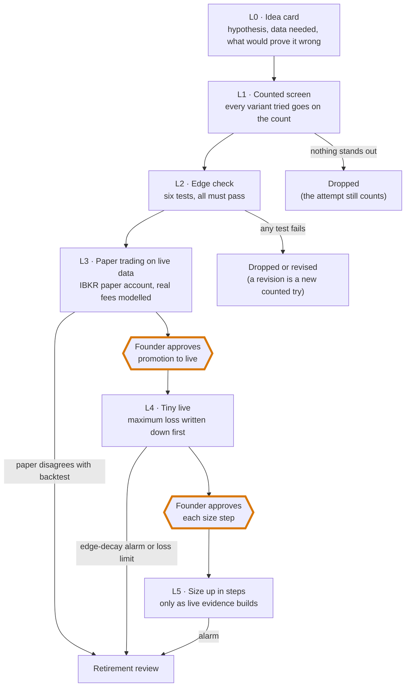
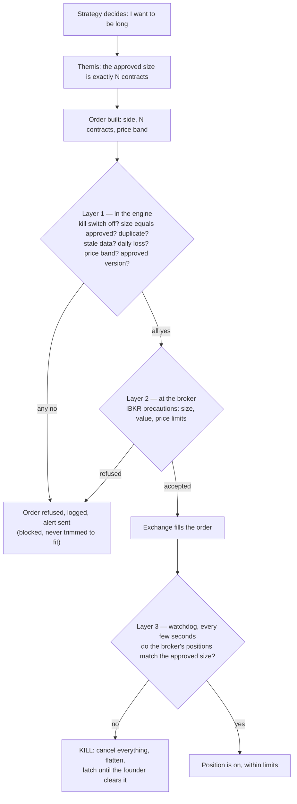
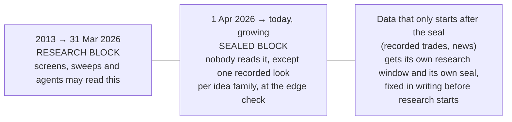
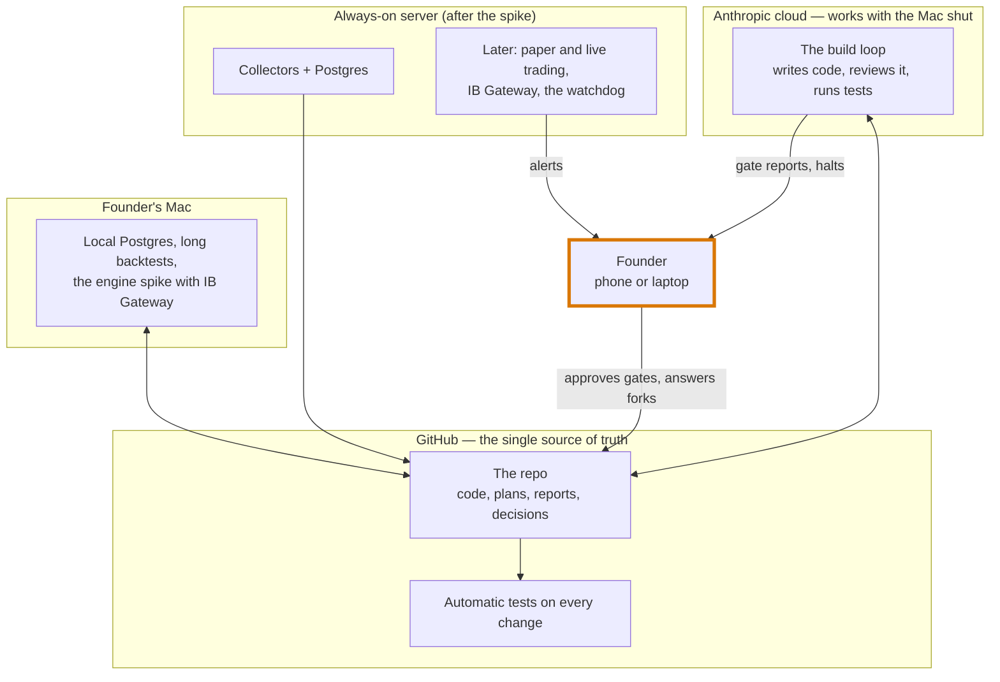
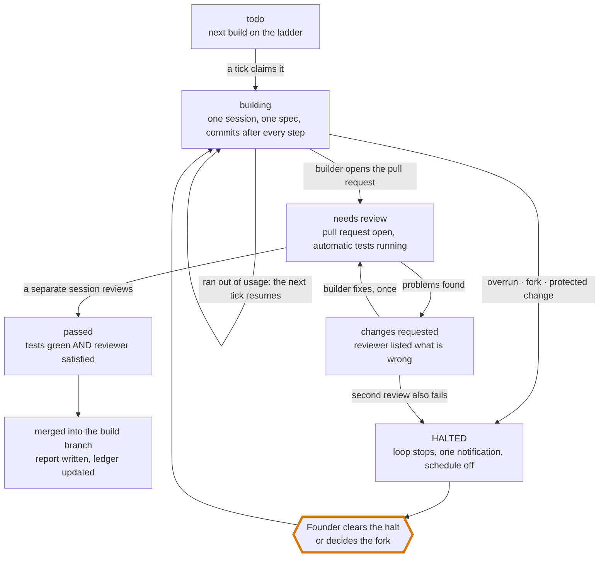
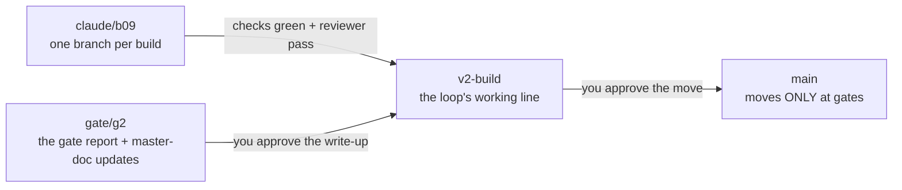
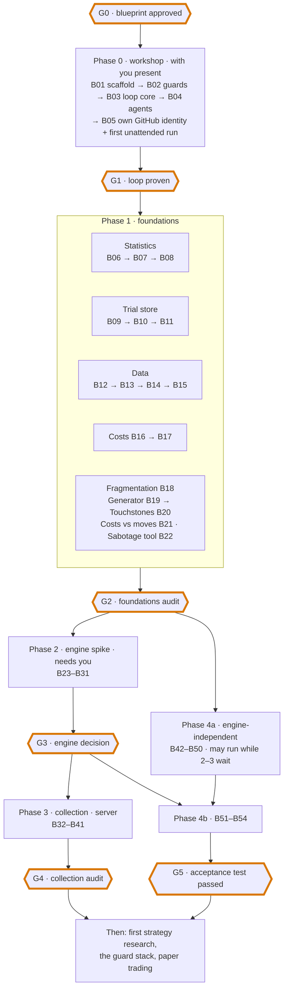

# CHRONOS v2 — BUILD BLUEPRINT (the skeleton)

**Status: DRAFT v0.4, 16 Nov 2026 (UTC): revised after three red-team passes (`gates/G0-redteam.md`); the third said "adopt with fixes", and this version has those fixes. Not adopted until the founder approves gate G0.**
Companion to the master document `docs/v2/CHRONOS_V2.md`, which still wins if the two disagree (§0 there).

This file answers three questions:

1. **What is Chronos, as a system?** Part 1: line diagrams, top to bottom.
2. **How do we build it without the founder carrying messages between chats?** Part 2: the build loop, its checks, its brakes.
3. **In what order, in what size pieces?** Parts 3–7: what we reuse from v1, when each outside component enters, and the ladder of builds, each sized to one session, with a gate after each phase.

Companion files in this folder:

| File | What it is |
|---|---|
| `HANDBOOK.md` | The founder's manual: what to click, what each report means, what to do when the loop stops, which model to use, what to do when usage runs out |
| `LADDER.yaml` | The same ladder as Part 5, in a form the loop's script reads. If the two disagree, `LADDER.yaml` is what runs, and that is a bug to fix |
| `LEDGER.md` | Estimate vs actual for every build. The plan is re-sized from this, not from hope |
| `V1_CARRYOVER.md` | Every v1 file: port, adapt, reference or retire, and which build takes it |
| `BUILD_CARDS.md` | One card per build for phases 2–4 (the spike, collection, the acceptance test) |
| `specs/B01…B22`, `specs/B43…B50` | One full spec per build for phases 0–1, and for the engine-independent part of phase 4 (the validation machine, written 17 Nov). A build session needs nothing but its spec and the files the spec lists |
| `gates/` | The red team's findings on this blueprint (`G0-redteam.md`) and one report per gate |

**Words used here.** A **build** is one piece of work small enough for one session, ending in one pull request. A **tick** is one wake-up of the loop: it does one thing (build, review, fix or merge) and stops. A **gate** is a checkpoint where the loop stops and waits for the founder. The **loop** is the scheduled wake-ups plus the rules in Part 2.

---

## Part 1 — The system in lines

Read each diagram top to bottom. Solid boxes are things we build or run. **Thick orange borders are the founder.** **Dashed borders are places where an AI model is allowed to think**; everything else is ordinary deterministic code. A model's output never crosses into the order path except as a number that deterministic code has checked, sized and limited (hard rule 1, V2-D07).

### 1A. The whole machine

```mermaid
flowchart TD
  subgraph SRC["1 · THE OUTSIDE WORLD"]
    KR["Kraken spot<br/>candles and trades<br/>(signal history)"]
    IB["IBKR crypto futures<br/>quotes, funding, fees, fills<br/>(what we actually trade)"]
    NW["News, X, GDELT, Grok"]
    MC["Macro releases"]
  end

  subgraph COL["2 · COLLECTORS — always-on server (after the spike)"]
    BG["Budget guard<br/>every paid call is reserved first"]
    RC["Recorders<br/>raw files + hashes, gaps logged, never papered over"]
  end

  subgraph OCE["3 · OCEANUS — data"]
    VC["Validate and clean<br/>never interpolate, report every dropped row"]
    ST["Store<br/>Parquet + DuckDB for prices and trades<br/>Postgres for events<br/>every snapshot has a hash"]
    DOOR["THE DATA DOOR<br/>the only way research reads data<br/>refuses anything from 1 Apr 2026 onward<br/>returns data + a footprint of what was read"]
  end

  subgraph RES["4 · RESEARCH — ideas become counted trials"]
    PRO["Prometheus<br/>AI research agents write idea cards"]
    FND["Founder ideas"]
    KRO["Kronos candle model<br/>a number fed to rules, no authority"]
    REG["Hypothesis registry<br/>claim, data needed, falsifier<br/>written BEFORE testing"]
    SCR["Screening<br/>fast sweeps<br/>EVERY variant tried is counted"]
  end

  MNE[("5 · MNEMOSYNE — the trial store<br/>every trial, its returns, its trades,<br/>its data footprint, its code version<br/>append-only: nothing edited, nothing deleted")]

  subgraph MOI["6 · MOIRAI — is the idea real?"]
    EC["Edge check<br/>enough data? · beats the count of tries? ·<br/>survives 2x costs? · beats random entries? ·<br/>not a lone lucky setting? · one look at sealed data<br/>(the verdict is stored in Mnemosyne)"]
  end

  VR["7 · VERSION REGISTRY<br/>baseline · candidate · paper · live · rolled back"]
  APP{{"FOUNDER APPROVAL<br/>thresholds · risk limits · go-live"}}

  subgraph TRD["8 · TRADING — deterministic only"]
    THE["Themis — sizing<br/>drawdown budget sets the size"]
    NAU["Strategy node on NautilusTrader<br/>same code in backtest, paper and live"]
    N1["Nemesis layer 1<br/>risk checks inside the engine"]
    GW["IB Gateway"]
    N2["Nemesis layer 2<br/>IBKR's own order limits"]
    EX["Exchange<br/>Coinbase nano BTC and ETH · CME micro"]
  end

  subgraph WAT["9 · WATCHING — three independent watchers"]
    N3["Nemesis layer 3 — watchdog<br/>separate user, separate connection<br/>reads the broker's own positions"]
    ALE["Aletheia — reconciliation<br/>our books vs the broker's"]
    ARG["Argus — monitoring<br/>edge-decay alarm, alerts"]
  end

  STOP["STOP<br/>no new entries · or cancel everything and flatten<br/>latched until the founder clears it"]
  PH["Founder's phone"]
  CC["10 · MOIRAI again — change check<br/>is a new version better<br/>AND profitable on its own?"]

  KR --> RC
  IB --> RC
  NW --> BG --> RC
  MC --> RC
  RC --> VC --> ST --> DOOR
  DOOR --> PRO
  DOOR --> KRO
  DOOR --> SCR
  PRO --> REG
  FND --> REG
  KRO --> REG
  REG --> SCR
  SCR --> MNE
  MNE --> EC
  DOOR -->|"one sealed look, recorded"| EC
  EC -->|"pass"| VR
  VR --> APP
  APP -->|"approved version and size"| THE
  THE --> NAU --> N1 --> GW --> N2 --> EX
  EX -->|"positions"| N3
  EX -->|"fills"| ALE
  EX -->|"results per trade"| ARG
  N3 -->|"size not as approved"| STOP
  ALE -->|"mismatch"| STOP
  ARG -->|"edge fading"| STOP
  STOP --> PH
  ARG -->|"paper and live results"| CC
  CC -.->|"improved version, or retirement"| VR

  classDef founder stroke:#d97706,stroke-width:4px;
  classDef ai stroke-dasharray: 6 4;
  class APP,FND,PH founder;
  class PRO,KRO ai;
```



What to take from it:

- **Data flows down, evidence flows into the middle, money only moves at the bottom.** Nothing in boxes 4–6 can place an order.
- **Mnemosyne (5) is the memory that keeps us honest.** If a try isn't in it, it didn't happen; if it is in it, it can't be removed.
- **Three layers can refuse or stop an order** (Nemesis 1–3), and three watchers can trigger a stop. STOP acts on the engine and on the gateway; it is latched, and only the founder clears it. The founder's approval sits between "it passed" and "it trades".

### 1B. The evidence ladder — how an idea earns money



### 1C. The order path — what stands between a bug and your money



The rule behind all three layers: **fail closed**. If a guard is down, slow or unsure, the answer is no.

### 1D. Time and the seal — what research may look at



Why it matters: a statistical test can only correct for tries it is told about. The sealed block catches what nobody counted. Reading it twice for the same idea is refused by the database, not by good intentions (V2-D34, V2-D38, V2-D46).

### 1E. Where things run



### 1F. Where the code lives

```
chronos/                         (this repo, public)
├── CLAUDE.md                    rules every session reads
├── docs/v2/
│   ├── CHRONOS_V2.md            MASTER DOCUMENT — wins every disagreement
│   ├── BUILD_NOTES.md           traps, by component
│   ├── COMPONENTS.md            where every outside piece comes from
│   ├── CODEBASE.md              what every file is
│   ├── CHANGELOG.md             dated work log
│   └── build/                   ← THIS FOLDER: blueprint, handbook, ladder, specs, reports, gates
├── v2/                          ← ALL NEW CODE (its own uv project, Python 3.14, V2-D45)
│   ├── pyproject.toml  uv.lock
│   ├── src/chronos2/
│   │   ├── core/                time, ids, config hashing, money types
│   │   ├── stats/               ported statistics + rank counters
│   │   ├── mnemosyne/           trial store (Postgres)
│   │   ├── oceanus/             data: schema, store, validate, clean, the door
│   │   ├── costs/               venue fees, cost components, stress runs
│   │   ├── moirai/              validation: fragmentation warning, later edge and change checks
│   │   └── fixtures/            synthetic worlds, touchstones
│   ├── migrations/              database schema, numbered SQL files
│   ├── tests/                   mirrors src/, plus known_answers/
│   ├── config/                  venue fees; protected/ holds seal dates and stress settings (founder-owned)
│   └── tools/                   loop/ (the "what's next" script) · guards/ (the checks) · sabotage/ · v1_oracle/
├── .claude/                     agent definitions and commands for the loop
├── .github/workflows/           v1 tests (untouched) + v2 tests and guards
├── src/  tests/                 v1, FROZEN — never edited (V2-D29)
└── docs/v1-archive/             v1 documents, frozen
```

---

## Part 2 — The build system

### 2.1 What was wrong, and the replacement

**Before:** project chat writes a prompt → the founder pastes it into Claude Code → pastes the output back → the chat judges it → repeat. The founder is the message bus, the plan lives in chat memory, and one "session" has no size limit.

**After:** the instructions live in the repo as spec files. A scheduled session reads the next spec, builds it, and opens a pull request. A second, separate session reviews it against the spec. Automatic tests judge both. The founder is asked only for things that are his: gates, forks, protected changes.



### 2.2 The roles, and what each one may write

| Role | Who | May write | May never do |
|---|---|---|---|
| **Builder** | A fresh AI session, model named in the spec | The files its spec lists; its report; its own status (`building`, `needs_review`, `halted`) | Edit v1. Touch earlier tests. Write a review. Set a build to passed or merged. Merge anything |
| **Reviewer** | A different fresh session that has never seen the builder's reasoning. Always Opus | The review file; the status (`passed`, `changes_requested`, `merged`); the ledger row. Merges a passing build into the build branch | Change code or tests, even one character |
| **Checks (CI)** | GitHub, automatic, on every pull request | Decide pass or fail with no opinion involved | — |
| **Founder** | You | Approve gates. Decide forks and protected changes. Approve any change to the rules themselves. Clear halts. Take over any build by hand | — (you can do anything; the system never *requires* more than this) |
| **Auditor** (gates only) | A session that saw neither the building nor the reviewing | The gate report and the master-doc updates, in a pull request you approve | Change code |

Every commit on a build branch says which role made it. The checks read that label and refuse a builder commit that writes a review or marks its own work passed, a reviewer commit that touches code, and a "passed" with no review of the current code (`specs/README.md`, "Who may write what"; built in B02).

**What that does and doesn't prove.** The label is one a session puts on its own commit, and builder and reviewer act through the same GitHub account. So the check catches a session doing the wrong job by mistake; it can't catch one that lies about which role it is. The first two red-team passes pressed on this (`gates/G0-redteam.md`). The honest position: builder–reviewer separation is a **guard rail**, kept by the loop starting a fresh session for each action and checked afterwards at each gate. It becomes a wall only if the reviewer gets an identity of its own, which is a decision for you at G1 (2.5).

Why builder and reviewer are separate sessions and not "one smart agent": a session that wrote the code believes its own story about it. Every tick of the loop starts a fresh session with no memory of the last one [Certain — Claude Code scheduled-task docs, read 16 Nov].

### 2.3 What a tick does

One scheduled task wakes the loop (at most hourly; that is the platform's minimum [Certain — same docs]). Each wake-up:

1. Runs a small deterministic script (`v2/tools/loop/next_action.py`). **Code, not an AI, decides what is next**, by reading `LADDER.yaml`, the branches and each build's status file. Next is the first build on the ladder whose prerequisites are done; one build is finished (built, reviewed, merged) before another starts. The full decision table (28 cases) is in `specs/B03-loop-core.md`.
2. Does exactly one action: start a build · resume a build · review · fix · merge · run a gate audit · or nothing.
3. Commits its progress and stops.

If the script says "waiting on the founder" or "halted", the loop sends one notification and **switches its own schedule off**, so it doesn't burn usage waking up to do nothing. Turning it back on is one sentence to Claude ("resume the loop") or one switch in the app.

**Running out of usage mid-build is normal, not a failure.** Every spec is an ordered checklist, and the builder commits after each step. The next tick reads the spec, the checklist and the diff, and carries on. Nothing depends on a session's memory.

**Taking over by hand.** In any Claude Code session (cloud, desktop app or the Mac terminal) the same commands work: `/tick` does whatever is next, `/status` says where things stand in plain words. A manual session and the loop can't collide: before any action (building, reviewing, merging), a session takes a lock by creating a branch named `lock/<build>` on GitHub. GitHub refuses to create a branch that already exists, so exactly one session wins. The lock is renewed on every push and counts as abandoned after three hours of silence.

### 2.4 Branches: why `main` can't rot



- **`main` is the only thing that is trusted.** `v2-build` is a workbench: builds merge into it on their own when the checks are green and the reviewer has passed them, and anything on it can be thrown away back to the last gate.
- **`main` moves only when you approve a gate.** A gate is two pull requests, both opened for you by the loop: first the **write-up** (the gate report and the updates to the master document), which is the one to read; then the **move** of `main`, which is one click. A gate counts as done when its report is on `main`.
- **Rule changes need you.** Every file in the repository has a named owner, you, except the folders builds do their work in (the v2 package, its tests, build reports, the changelog and a few others). So the checks, the workflows, the loop's own code, the specs, the ladder, this blueprint, the master document, `CLAUDE.md`, the list of libraries and the protected values are all yours. From B05, a pull request that touches one can't merge without your review, and if anything is added after you review it, GitHub asks you again.
- **Between gates, document changes you approve** (a new decision, research notes) go to `main` as they do today. The next gate's write-up merges `main` into the working line, so the two never drift apart. If a decision made mid-phase changes what a build should do, the build's spec is corrected (a small pull request you approve); builds follow their specs.
- **None of this is a wall until build B05.** Until then every Claude session acts on GitHub as you, so GitHub can't tell your approval from the agent's. In B05 the automation gets its own account, GitHub's rules are switched on, and then **the automation attacks them**: twelve named tests (merge into `main` with no approval; push to a pull request you opened and approve it; add a commit after you approved; fake a passed check; change a workflow, a library, a protected value, the loop's own code or a rule). Each must be refused by GitHub, and for the reason named: a test refused for some other reason is run again. A protection whose attack isn't refused is written down as a guard rail, and you decide what to do about it.

### 2.5 The five layers of checking

| # | Layer | When | What it catches |
|---|---|---|---|
| 0 | **Spec** | Before any code | The pass/fail checks and the known answers are written first, by a session that isn't doing the build. The checks read each spec from the base branch, so editing your own spec on your own branch changes nothing |
| 1 | **Automatic checks on every pull request** | Every build | Wrong numbers (known-answer tests). Edits to v1 (compared against `v1-final`: must be empty). Edits outside the files the spec lists. An existing test file changed, deleted or renamed. The earlier builds' tests, **run again from the base branch's copy** so nothing this build put in the tests folder can affect them. A role writing what it may not. A protected value changed. An instruction file planted in a source folder. A library added that the spec doesn't name. Timezone not UTC |
| 2 | **Independent reviewer** | Every build | Code that passes tests but doesn't do what the spec says. Tests that can't fail. Anything that changes how tests run. Hard-rule violations (CLAUDE.md 1–10). It must run the checks itself and break one thing on purpose to see a test go red |
| 3 | **Gate audit** | End of each phase | The tests as they stood at the previous gate, taken from `main`, re-run unmodified against today's code. Every build's review checked: it exists, names the real commit, and was made by a different session from the build. Every rule file that changed during the phase, listed for you with its diff. Blind re-derivation of key numbers. **Sabotage run** (the tool is build B22): the code is changed on purpose, automatically, many times; every change the tests don't notice is listed and must be answered. End-to-end run. Docs match reality. Estimates vs actuals |
| 4 | **Founder** | Gates only | Whether the direction is still right. Each gate report has "three things you can check yourself" in plain language |

Two rules sit across all layers:

- **Known answers come from outside the builder's head.** From the papers, from v1's own passing tests, or from a second library (`arch`, `quantstats`, `ml4t-diagnostic`). "The model remembers the formula" is not a source (hard rule 5).
- **Every check must be able to fail.** A check that has never been seen red proves nothing. Layers 2 and 3 both exist to see it red.

**What kind of protection each thing is.** Three words, used the same way everywhere in this pack:

- a **wall** is enforced by GitHub or the database whatever an agent intends, *and has been attacked and held* (B05 for GitHub, B09 for the database);
- a **tripwire** is an automatic check that catches mistakes and shortcuts, and that a session determined to cheat could get around;
- a **guard rail** depends on sessions following their instructions.

Earlier drafts of this table called tripwires and guard rails walls; the red-team passes said so, three times. This version claims a wall only where an attack test exists, and the "from" column is conditional on that test passing.

| Protection | What it is | Becomes a wall |
|---|---|---|
| Nothing reaches `main` without your approval of exactly what is merged (code only at gates; documents when you approve them) | Guard rail until B05 | **B05**, if attacks A1–A6 are refused and A12 finds no third account that can approve |
| The rules can't change without you (checks, workflows, the loop's code, specs, ladder, master doc, `CLAUDE.md`, libraries and their lock file, protected values) | Tripwire from B02 (the `protected` check); guard rail before | **B05**, if attacks A6–A9 are refused |
| Your emergency stop (the labelled issue) can't be undone by the automation | **Guard rail, and it stays one.** From B03 the loop ignores a stop that any account but yours closes or unlabels (tested, A11), but that rule lives in the loop's own code | No. The switches nothing can override are yours: turn the scheduled task off in the Claude app, or remove the automation's account from the repository |
| v1 can't be edited | Tripwire from B02 | From G1, at each gate: the gate move can't merge with a v1 change, because the check is required on `main` and its code comes from `main`'s own copy. (At G1 itself `main` has no copy yet, so the check uses the pull request's; you are present for it.) |
| A build stays inside the files its spec lists, and can't widen its own spec | Tripwire from B02 | No. A phase's worth of out-of-scope changes is shown to you at the gate |
| Earlier tests can't be changed, deleted or switched off | Tripwire from B02: existing test files are frozen; and the earlier tests are re-run from the base branch's copy of everything except the package itself, with plugins off and the count of tests checked | No. A session could still defeat a test from inside new *package* code. The reviewer, the gate's re-run of the last gate's tests, and the sabotage run are what catch that |
| The builder can't approve its own work | Tripwire from B02 (role labels) + guard rail (fresh sessions) | Only with a reviewer that has its own identity: your decision at G1 |
| A new test checks as much as its spec says | Guard rail (the reviewer) + the sabotage run at gates | No |
| Known answers are right | Tests assert the numbers in the spec; v1's numbers are regenerated from v1 itself in CI (a tripwire stops an existing oracle script being edited) | The spec's own numbers were re-run by two red-team passes (the first found four wrong; the second re-ran six and all matched) and are re-derived blind at gates |
| Trial records can't be changed or deleted | — | **B09**: database permissions and triggers, attacked in tests. A database superuser can still disable triggers; the audit detects it afterwards |
| Research can't read sealed data | Tripwire: a test that nothing reads the files around the door | **B14** for reads through the door (it refuses) + **B11** (an audit over every stored footprint) |
| The loop can't spend money | It never runs a model billed per use | Your usage-credit limit, once you set it (HANDBOOK §6) |

**The honest summary.** Between gates, on the working line, the automatic checks are good at catching mistakes and bad at stopping deliberate deception, and nothing on GitHub can fully fix that while builder and reviewer share one account. What the design guarantees instead: nothing reaches `main` without you; at every gate the phase is re-checked from clean, by a session that built none of it; and the worst case of a bad or dishonest build is redoing part of one phase, not building months of work on it. If you want more than that between gates, the two real options are a reviewer with its own identity or merging each build yourself (B05 "Halt if" lists both); that is a G1 decision, with B05's measurements in hand.

### 2.6 Brakes: when the loop stops itself

A build is **halted** (status `halted`, with the reason and the options written into its status file, and one notification) when any of these happens. A halted build blocks only the builds that need it; the loop carries on with any other chain that is runnable, and switches its schedule off when nothing is. The two triggers marked *global* stop everything.

| Trigger | Why |
|---|---|
| A build fails review twice | Two tries means the spec or the approach is wrong, not the typing |
| A build overruns its size budget (2.7) | The estimate was wrong. Stop, split it, renumber, record it |
| Tests go red on `v2-build` *(global)* | Something merged that shouldn't have |
| The builder hits a fork between non-equivalent options, or a conflict with the master doc | Hard rule 9: only the founder decides |
| A change touches a protected value (validation thresholds, risk limits, promotion to live, a seal date) | Hard rule 7: show the diff and wait |
| The v1 guard trips *(global)* | v1 is frozen |

A halt is cleared by the founder, usually with one sentence in a session ("split it as proposed", "take option b"). Nothing proceeds around a halt.

**The big red button.** Saying "halt the loop" to Claude, or opening a GitHub issue with the label `chronos-halt` from your phone, stops every action until **you** close the issue. It needs no pull request and can't be blocked by a check; and if any account other than yours closes it or takes the label off, the loop treats it as still in force. That rule is the loop policing itself, so treat this button as the convenient stop, not the last resort. **The last resort is yours alone and nothing can override it: switch the scheduled task off in the Claude app, or remove the automation's account from the repository on GitHub.**

**When a spec is wrong.** The build halts. The correction is made on its own small branch (`spec/…`), which needs your approval because specs are yours; then the build resumes. A builder never fixes its own instructions.

### 2.7 What "one session" means here

The past problem (a plan of 5 sessions taking 12–13) has two causes this blueprint attacks directly: builds with no size limit, and plans never corrected against reality.

**Size classes.** Every build is S or M. There is no L: a build that would be L is split before it starts.

| | S | M |
|---|---|---|
| New or ported code | ≤ 150 lines | ≤ 400 lines |
| Tests | ≤ 300 lines | ≤ 600 lines |
| Files touched | ≤ 8 | ≤ 14 |
| New outside libraries | 0–1 | ≤ 2 |
| Reading list (spec + sources) | ≤ 800 lines | ≤ 1,500 lines |
| Build ticks allowed | 2 | 3 |
| Ideas | one | one |

These numbers are my estimates of what fits in one unhurried session with room to test [Guessing — to be measured]. That is why:

- **`LEDGER.md` records estimate vs actual for every build** (ticks, lines, review rounds).
- **Gate G1 and gate G2 re-size the rest of the ladder from those numbers.** If M builds keep needing 4 ticks, M shrinks.
- **I can't promise a count of sessions** [Certain]. What the system guarantees instead: an overrun is caught at the first build it happens in, costs one halt, and updates every later estimate.

Honest count as planned: **54 builds and 6 gates to the end of the acceptance test** (master doc §9 steps 2–5). The first draft said 49; the red team found two builds too big to be one session (now split into four), and three jobs the plan needed but had no build for (file loaders, the sabotage tool, loading the full Kraken history). Of the 54, 30 are fully specified (B01–B22, and B43–B50 since 17 Nov: those don't depend on the engine, V2-D50); the rest have cards (`BUILD_CARDS.md`) and get full specs when their phase opens, because the engine spike can still change what they should say. Expect the count to move again at G1 and G2: that is the ledger doing its job, not the plan failing.

### 2.8 Which model does what — decided by the spec, not by you

| Work | Model | Why |
|---|---|---|
| Reviews, gate audits | **Opus**, always | The check must be at least as strong as the work |
| Any build that touches code or tests under `v2/` | **Opus** | It affects results |
| Docs-only or CI-wiring builds, report formatting | **Sonnet** | No effect on results; the reviewer is still Opus |
| Planning, architecture, spec writing, red-teaming a plan | **Fable while the plan allowance lasts, else Opus** | Highest-stakes thinking; rare |
| Anything in the loop | **Never Fable, never a local or third-party model** | On the Pro plan Fable is billed separately as usage credits [Certain — Anthropic support article, read 16 Nov]; an unattended loop must not be able to spend money |

Every spec carries a `model:` line. The loop obeys it. When you run a build by hand, `/tick` first says "this build wants Opus; you are on X" and stops until it matches. You never have to judge it.

### 2.9 Money

The founder's figure for month one was US$100 for everything, with this instruction on 16 Nov: *the cap is not hard; say where more money buys something clearly better.* Today's spend is Claude Pro, $20.

**Where more money changes the outcome, in order of value.** The first draft of this section said "stay on Pro and measure first". With a soft cap that was too timid, for the reason in row 1.

| # | Spend | Cost | What it buys | Weakest part of the case |
|---|---|---|---|---|
| 1 | **Claude Max instead of Pro, for the build months** | $100/month (+$80) | About five times the allowance, per five hours and per week [Likely]. Fable for planning inside the plan (up to half the weekly allowance) instead of pay-per-use [Certain — Anthropic help page, read 16 Nov]. On Pro, one planning session plus one review used a whole five-hour window on 16 Nov [Certain — it happened: the red team was cut off]. The loop needs a builder and a reviewer per build, 54 times | Nobody has measured a build tick yet. B05 does. If B05 shows Pro would have been enough, drop back; the plan can change monthly |
| 2 | **A few hours of an independent human reviewer** (someone who reads Python and statistics) at G5, and again before real money | a few hundred dollars, twice [Guessing — no quote taken] | The one thing this design lacks: every builder, reviewer and auditor is an AI, mostly from one family. G5 is where the validation thresholds are set; a human who has seen none of it re-deriving two or three numbers is a different kind of check | Finding the right person. A weak reviewer adds false comfort. Not needed before G5 |
| 3 | **A reviewer from a different AI family** (P-20) | $20/month from G1 | A partial answer to the same weakness, on every build instead of twice. Judged at G2 by what it caught that Claude's reviewer missed; dropped if nothing | It may catch nothing. You don't have the subscription today |
| 4 | **Rent the server at G2 instead of after the spike** (proposal P-21) | about $10–30/month [Guessing — no quote taken] | Headlines as published can't be collected afterwards. Starting at G2 gains roughly the length of the spike: a few weeks of headline history | A small gain, and you weighed this on 3 Nov when you locked V2-D30. What is new is only that the cap is soft and that the spike waits on your calendar. Spread snapshots and paid sources can't start early anyway (they need the spike and the budget guard). I'd take it only if the spike slips |
| 5 | **Storage** | $0 if the external SSD the master doc mentions has 500 GB free; otherwise about $80–120 once for 1 TB [Guessing] | Your Mac has 256 GB. Multi-year one-minute data, trade files and the spike's working files will not fit comfortably beside everything else | None; it is also the backup drive |
| 6 | **Rented compute by the hour for the big calibration run** (B53) | tens of dollars, once [Guessing] | Thousands of simulated worlds in hours instead of days on a 16 GB laptop | Not needed until phase 4; decide then with a measured run time |
| 7 | **Paid history**: quotes for the futures we trade; a news archive with publication times | unknown: to be priced at the spike and when S-NEWS research opens | Real spreads for the cost model, and a past for S-NEWS, without waiting months for our own recordings | May not exist for the nano contract at any price; an archive's timestamps would need checking against our own recordings |

**Where more money buys little** [Likely]: hardware to run AI models locally (a 16 GB Mac can't run a model good enough to write this code, and a machine that can costs more than years of Max); a new Mac; pay-per-use credits as the main way to run the loop (unbounded, unattended); the top plan before the middle one has been measured.

**Free, and worth more than several of the above:** the automation's own GitHub account (B05). Without it GitHub can't refuse the automation anything, because it can't tell it from you.

**What stays true whatever is spent:** the loop never runs a model that bills per use; your usage-credit limit is set before the loop is switched on (HANDBOOK §6).

| Item | Monthly | Status |
|---|---|---|
| Claude Pro | $20 | Have it |
| Claude Max | $100 | Claude's recommendation was "from B01". **Founder, 16 Nov: not now, maybe in a couple of months.** Revisited at G1 with B05's measurements |
| Second-family reviewer | $20 | From G1 (P-20), reviewed at G2 |
| Server | $10–30 [Guessing] | After the spike (V2-D30), or from G2 if you accept P-21 |
| Human review | one-off, a few hundred dollars [Guessing] | At G5; your call then |
| Paid APIs (Grok, Claude API for collectors) | budgeted in V2-D41 | Phase 3, behind the budget guard |

With Max that would be roughly $120 a month through phase 1 and $130–150 from G2: inside the running budget already locked in V2-D13. On Pro it is $20, plus $20 from G1 if the second reviewer is confirmed.

**Staying on Pro (the founder's choice for now).** The plan works on Pro; it is slower. Builds are cut into steps that are saved as they go, so a session cut off by the usage limit resumes where it stopped. Three things follow:

1. **Build and review on Opus, not Fable.** On Pro, Fable is billed separately as usage credits once the launch offer ends [Likely]. Planning sessions use Opus too unless you choose to pay for Fable.
2. **The allowance is shared with ordinary chatting** [Certain — Anthropic help page, read 16 Nov]. A heavy chat day slows the build.
3. **Nobody knows yet how many builds a week Pro supports.** B05 measures what a build and a review cost; the G1 report turns that into "54 builds take about this long on Pro", and the question comes back then with a number.

---

## Part 3 — What we keep from v1

The full file-by-file ledger is `V1_CARRYOVER.md`. Summary of the re-audit (16 Nov, all of `src/`, `tests/`, the root scripts; 7,341 lines of code, 5,873 of tests):

| v1 asset | Lines (code / tests) | Old plan | **After re-audit** | Build |
|---|---|---|---|---|
| Statistics core `moirai/statistics.py` | 270 / 407 | Port | Port, unchanged maths | B06 |
| Math probe `chronos_math_probe.py` (28 checks) | 340 | Port | Port as tests | B07 |
| Trial ontology in `run.py` (hypothesis, SEARCH/VERIFICATION, honest N) | ~120 of 346 / 143 | Port | Port the ontology; leave the engine glue behind | B10 |
| **Data layer: bar schema, Parquet store, snapshot hash** `oceanus/model.py`, `store.py` | 248 / 213 | Reference | **Port** (V2-D47) | B12 |
| **Data layer: validate, clean** `oceanus/validate.py`, `clean.py` | 261 / 213 | Reference | **Port** (V2-D47) | B13 |
| Data door `oceanus/access.py` + `seal.py` | 337 / 403 | Reference | Adapt: keep the single-door pattern and its tests' shape; the seal becomes date-based with a look limit | B14, B46 |
| Cost model `hephaestus/costs.py` | 140 / 130 | Reference | Reference: keep "no path around costs"; v2 costs are per-contract dollars, not basis points | B16 |
| Slippage method `measure_slippage.py` | 200 | Reference | Port the method onto a generic trade tape | B17 |
| Fragmentation screen in `stages/eligibility.py` | ~110 of 250 | Port | Port as a pure function over the trial store | B18 |
| Synthetic generator `calibration/generator.py` | 184 / 78 | Port | Port | B19 |
| Touchstones `calibration/touchstones.py` + fixture | 575 / 72 | Port | Port the **definitions** (worlds, rules, seeds) as data; the v1 runner is gauntlet-bound and stays behind | B20, B51 |
| Hashed, versioned config idea `moirai/config.py` | 125 / 227 | Reference | Port the canonical-hash helper into `core/` | B01 |
| Trade-shuffle drawdown, round-trip rebuild `trade_shuffle.py`, `round_trips.py` | 218 | Reference | Port into sizing (drawdown is a sizing input) | B50 |
| Cadence-matched random entries `moirai/nulls.py` | 114 | — | Reference for the v2 null; the recipe differs (V2-D21) | B45 |
| Engine `hephaestus/*`, gauntlet pipeline, stages 4.1/4.5–4.8/4.10, Binance ingest, v1 scripts | ~3,700 | Retire | Retire (unchanged verdict). The engine is used once more as the comparison in the spike | — |

**Net effect of the re-audit:** about 500 more lines of tested v1 code are ported instead of rewritten (the data layer), and the touchstones' definitions are separated from their runner so they survive the engine change. Nothing in v1 is edited, ever (V2-D29).

The v1 *commitments* that carry over unchanged are listed in the master doc §6 ("Kept from v1"): honest trial counting, DSR, dependence-aware statistics, provenance for every threshold, no seed shopping, sealed holdouts, asymmetric findings stated asymmetrically.

---

## Part 4 — When each outside component enters

Nothing third-party enters the code base until the build named here, and never without the entry test passing. Versions are pinned in `v2/uv.lock`; the lock file's hash is part of every trial's code coordinate (V2-D42).

| Component | Role | Enters at | Entry test (must pass in that build) | If it fails |
|---|---|---|---|---|
| Python 3.14, numpy, scipy, pandas, pyarrow | Base | B01 | All install together; smoke tests [already run 16 Nov: pass] | Fall back to 3.13 (V2-D45) |
| psycopg 3 + PostgreSQL 16 | Trial store | B09 | Append-only attack test: 8 of 8 destructive statements refused | Halt |
| `arch` | Second opinion: Newey–West, bootstrap; later SPA/StepM/MCS | B08 (test-only) | Matches our Newey–West to 1e-10 on the fixed series | Record the difference; ours stays |
| `quantstats` | Second opinion: Sharpe, PSR; later reports | B08 (test-only) | With `periods` passed, matches ours to 1e-9 | Same |
| `ml4t-diagnostic` | Second opinion: DSR (2025 form, labelled as such) | B08 (test-only) | Difference from ours is the documented one (BUILD_NOTES §2), no other | Same |
| duckdb | Queries over Parquet | Not before phase 3 (the first build that needs it adds it) | Bar counts at both ends of a half-open range | Use pandas only |
| NautilusTrader (pinned) | Engine | B23 (spike only) → adopted at G3 | The six spike criteria, master doc §9 step 3 | Re-argue the engine (V2-D04) |
| `ml4t-backtest` | Third opinion for fills | B24 (test-only) | Five fill tests; every difference explained (V2-D43) | — |
| IB Gateway + IBKR paper account | Execution | B26 | Nano contract found, subscribed, paper-traded both ways | Engine-choice problem: raise at once |
| VectorBT | Screening | B43 | The five-fix wrapper tests (BUILD_NOTES §2); 1.2.1 re-checked against the 1.2.0 findings | Hand-written vectorised screener |
| World Monitor news catalog (AGPL-3.0) | S-NEWS source list | B37 | Licence file added, notices kept (founder, 15 Nov) | — |
| Grok API, Claude API (collectors) | S-NEWS scoring | B39, only after B33 | Budget guard known-answer tests: over-budget plan → 0 calls | No paid collector runs |
| Kronos model | Shadow signal | After G5, after a baseline exists (V2-D05) | Training cutoff confirmed from the repo first | — |
| `tick`, OrderflowChart | Parked order-flow thesis | Not scheduled | — | — |

**AI models used to *build* Chronos are a separate matter** from models used *inside* Chronos, and are covered in 2.8 and the handbook. Local or third-party coding models never write code that reaches `v2-build` without passing layers 1 and 2 like anything else, and are never used for the builds marked Opus.

---

## Part 5 — The ladder

`who`: **loop** = runs unattended · **you+** = needs you present (your accounts, your Mac, your money, or your approval) · **gate** = stops for your approval. These tables are generated from `LADDER.yaml`; a test in B03 fails if they drift apart.

### Phase 0 — The workshop (no trading logic)

| Build | What | Size | Model | Who | Needs |
|---|---|---|---|---|---|
| **G0** | **This blueprint approved** | — | — | gate | — |
| B01 | v2 project scaffold, core helpers, automatic tests | M | Opus | you+ (by hand: no loop yet) | G0 |
| B02 | The guards: tripwire checks on every pull request, protected values, code owners | M | Opus | you+ (by hand) | B01 |
| B03 | The loop's decision core: ladder reader, next action, locks | M | Opus | you+ (by hand) | B02 |
| B04 | The loop's hands: agent definitions, commands, templates | M | Opus | you+ (by hand) | B03 |
| B05 | The automation's own GitHub identity, GitHub rules, attack tests, first unattended run | M | Opus | you+ (about 45 minutes of you) | B04 |
| **G1** | **The loop is proven.** GitHub refuses what it should. Estimates re-sized from B01–B05. Plan and second-reviewer choice reviewed | — | Opus | gate | B05 |

B01–B05 are run by hand, with you present, because the loop and its walls don't exist until B05 has proved them.

### Phase 1 — Foundations (master doc §9 step 2)

| Build | What | Size | Model | Who | Needs |
|---|---|---|---|---|---|
| B06 | Statistics I: the ported core, its known-answer tests, the v1 oracle | M | Opus | loop | G1 |
| B07 | Statistics II: the 28-check probe as tests, mid-rank counters, the floating-point tie case | M | Opus | loop | B06 |
| B08 | Statistics III: cross-checks against three outside libraries | S | Opus | loop (you approve its pull request: it adds libraries) | B07 |
| B09 | Trial store I: Postgres harness, migrations, append-only, audit | M | Opus | loop (you approve its pull request: it adds a library) | G1 |
| B10 | Trial store II: ids, code coordinate, hypotheses, SEARCH/VERIFICATION, honest N | M | Opus | loop | B09 |
| B11 | Trial store III: returns, trades, data footprint, compare guard, seal audit | M | Opus | loop | B10 |
| B12 | Data I: bar schema, Parquet store, snapshot hash | M | Opus | loop | G1 |
| B13 | Data II: validate and clean | M | Opus | loop | B12 |
| B14 | Data III: the data door, seal guard, footprints | M | Opus | loop | B11, B13 |
| B15 | Data IV: file loaders (Kraken candles, Bitstamp minute set) | S | Opus | loop | B14 |
| B16 | Costs: venue fee schedules, cost components, 2× and adverse-funding stress | M | Opus | loop | B11 |
| B17 | Slippage and spread measurement method | S | Opus | loop | B16 |
| B18 | Search-fragmentation warning | M | Opus | loop | B06, B11 |
| B19 | Synthetic world generator | S | Opus | loop | B12 |
| B20 | Touchstones as pre-registered fixtures (written down, not run) | M | Opus | loop (you approve its pull request) | B06, B19 |
| B21 | Costs vs typical price moves by holding time (P-12) | S | Opus | loop | B15, B16 |
| B22 | Sabotage harness: break the code on purpose, count what the tests miss | S | Opus | loop | B08 |
| **G2** | **Foundations audit.** v1-vs-v2 parity table, sabotage run, blind re-derivation, doc sync, re-size | — | Opus | gate | B06–B22 |

Three chains start independently here (statistics B06→B08, trial store B09→B11, data B12→B13), so a halt in one doesn't block the others. They join at the data door (B14).

### Phase 2 — The engine spike (step 3) · cards in `BUILD_CARDS.md`

| Build | What | Size | Model | Who | Needs |
|---|---|---|---|---|---|
| B23 | Spike prep: pinned NautilusTrader, data in, the v1 test strategy re-implemented | M | Opus | loop | G2 |
| B24 | Criterion (a): match v1's engine; five fill tests on two engines | M | Opus | loop | B23 |
| B25 | Criterion (b): our cost model plugged into the engine | S | Opus | loop | B24 |
| B26 | IBKR paper hookup on the Mac; find the nano contract | S | Opus | you+ (your accounts, your Mac) | B23 |
| B27 | Criterion (e): paper-trade nano both ways; funding, fees, nano contract bars | M | Opus | you+ | B26 |
| B28 | Criterion (f): broker refuses an oversize order; a second connection can flatten | S | Opus | you+ | B27 |
| B29 | Criterion (d): two strategies, two venues, one node | S | Opus | you+ | B27 |
| B30 | Criterion (c): several days unattended, across a Monday re-login | S | Opus | you+ (calendar time) | B28, B29 |
| B31 | Spike report | S | Opus | loop | B24, B25, B30 |
| **G3** | **Engine decision** (V2-D04 becomes final, or is re-argued) | — | Opus | gate | B31 |

### Phase 3 — Always-on collection (step 4) · cards in `BUILD_CARDS.md`

| Build | What | Size | Model | Who | Needs |
|---|---|---|---|---|---|
| B32 | Server up: hardening, Postgres, backups, UTC | M | Opus | you+ (you pay and click; Claude drives) | G3 |
| B33 | Budget guard for paid APIs (V2-D41) | M | Opus | loop | G3 |
| B34 | Collector frame: schedule, raw files and hashes, gap rows, alerts | M | Opus | loop | B32 |
| B35 | Kraken trade recorder (V2-D26) | M | Opus | loop | B34 |
| B36 | Kraken bulk trade files; side check against the recorder | M | Opus | you+ (one real file from you) | B35 |
| B37 | News catalog import (AGPL licence), headline recorder | M | Opus | loop | B34 |
| B38 | GDELT collector | S | Opus | loop | B34 |
| B39 | Grok/X collector, both scorers logged | M | Opus | you+ (API keys) | B33, B37 |
| B40 | Macro actuals with release times | S | Opus | loop | B34 |
| B41 | IBKR spread snapshots (IB Gateway on the server) | M | Opus | you+ | B34 |
| **G4** | **Collection audit:** a week unattended, gap report, spend report | — | Opus | gate | B35–B41 |

### Phase 4 — The validation acceptance test (step 5) · cards in `BUILD_CARDS.md`

| Build | What | Size | Model | Who | Needs |
|---|---|---|---|---|---|
| B42 | Load the full Kraken 1-minute history; real-file check of the loader | S | Opus | you+ (you download the files) | G2 |
| B43 | Screening wrapper: five fixes, every variant a counted trial | M | Opus | loop | G2 |
| B44 | Look-ahead test kit: slice, warm-up, nudge | M | Opus | loop | B43 |
| B45 | Null benchmark (V2-D21) with its four known-answer tests | M | Opus | loop | B43 |
| B46 | Sealed-look ledger, series windows; refusal enforced in the database | M | Opus | loop | G2 |
| B47 | Edge check I: frozen config, data sufficiency, DSR at honest N, cost runs, basis check (P-15) | M | Opus | loop | B43, B46 |
| B48 | Edge check II: neighbourhood, sealed-look confirm, warnings, one fixture per test | M | Opus | loop | B45, B47 |
| B49 | Change check with its fixtures (V2-D32) | M | Opus | loop | B47 |
| B50 | Sizing v0: drawdown budget, ruin formula, bootstrap check | M | Opus | loop | G2 |
| B51 | Run the touchstones against their pre-registered verdicts | M | Opus | loop | G3, B44, B48, B50 |
| B52 | Planted-edge calibration: write the criteria (before running) | S | Opus | you+ (you approve the criteria) | B48 |
| B53 | Planted-edge calibration: run it, pick the rule by the written criteria | M | Opus | loop (long compute) | B51, B52 |
| B54 | Acceptance report | S | Opus | loop | B49, B53 |
| **G5** | **Acceptance test passed** → V2-D08 stops being conditional. Blind re-derivation required | — | Opus | gate (protected) | B42, B54 |

**Sequencing rule (V2-D50).** Phase 2 needs you and a week of calendar time. So the loop doesn't sit idle, builds B43–B50 don't depend on the engine and may run while phases 2–3 wait on you. B51–B54 wait for G3. Nothing from phase 4 is *trusted* until G5.



---

## Part 6 — What a gate looks like

Every gate produces one file, `gates/Gn-report.md`, written by the auditor, with the same sections every time:

1. **Verdict** in one line: ready to approve, or not and why.
2. **What was built** since the last gate, in plain words, one line per build.
3. **What the audit tried to break, and what broke.** Sabotage survivors listed one by one. The previous gate's tests re-run unmodified. Every rule file changed in the phase, with its diff. Which protections are walls today and which aren't.
4. **Numbers re-derived blind**, side by side with the build's own.
5. **Plan vs reality:** ticks, lines, review rounds, halts; the re-sized ladder if estimates were off.
6. **Three things you can check yourself** without reading code and without a terminal: each is "open this page or file, find this line, it should say X". (If a check needs a command, the report gives the sentence to say to Claude and the answer to expect.)
7. **Decisions waiting for you**, each with options and a recommendation.
8. **Master-doc changes** this gate will make to §2 and §10 when approved.

Approving a gate is two clicks on GitHub, on two pull requests the loop opens for you: approve and merge **the write-up** (this report plus the master-doc updates; read this one), then approve and merge **the move of `main`**. Telling Claude "approve G2" in a chat is not enough once B05 is done: the approval has to come from your own GitHub account, which is the point. If anything is pushed to a pull request after you approved it, GitHub throws your approval away and asks again; that is deliberate. When the report is on `main`, the next tick of the loop carries on.

---

## Part 7 — After G5 (outline only; specs written when each phase opens)

| Phase | What | Entry | Exit |
|---|---|---|---|
| 5 | **S-INTRADAY research** with S-TREND as filter and benchmark: idea cards → pre-registered rules → counted screens → edge check | G5; cost-feasibility floor from B21 written down | A candidate passes the edge check, or the family is honestly dropped |
| 6 | **The guard stack:** full sizing, Nemesis in three layers, edge-decay alarm, reconciliation, version registry with founder-signed approvals. **Hardening:** a separate operating-system account for automation on the server (the separate GitHub identity is already in place from B05) | A candidate exists | Self-test: every known-bad order refused; kill switch latched; mismatch halts |
| 7 | **L3 paper** on IBKR | Phase 6 exit | Paper agrees with backtest within stated bounds; ≥ 200 trades for the confirm rule if the sealed block couldn't supply them |
| 8 | Kronos shadow signal | A baseline exists | Each of its three roles judged separately |
| 9 | Research MCP server | Phases 4 and 2 exist to wrap | Tool list asserted at startup; every answer carries its footprint |
| 10 | **L4 tiny live → L5** | Founder, O-7 answered | — |
| — | FX and equities unpark | Crypto at L3 | — |

---

## Part 8 — Decisions and proposals this blueprint raised

**Accepted by the founder on 16 Nov** ("it's a go"), recorded in the master doc §10 (P-16 to P-19 as decisions; P-20 as an instruction):

| Was | Now | Decision |
|---|---|---|
| P-16 | **V2-D47** | Step 2 also ports a minimal data layer (B12–B15), so the data footprint V2-D42 requires is real from the first trial |
| P-17 | **V2-D48** | The edge check takes its input in one standard form (returns, trade list, cost components per trade) from any engine. The acceptance test runs on the screening wrapper for speed; a sample is re-run on the real engine to show both give the same answer |
| P-18 | **V2-D49** | v2 expectations are pre-registered for T-a1 (written with its reasoning in B20, before anything runs) and T-c (the deliberate look-ahead must be caught by the look-ahead kit and never reach the edge check) |
| P-19 | **V2-D50** | Engine-independent parts of step 5 (B42–B50) may be built before the spike finishes. Nothing from them is trusted until G5 |
| P-20 | **not locked** | The founder left this to Claude's judgement ("if you feel it's required and it's good, then sure"). Only the founder locks decisions, so it is recorded as an instruction, not a decision. Claude's call: **yes, as a trial from G1, confirmed by the founder at G1 before any money is spent.** The second red-team pass raised its value: a reviewer acting through its own GitHub identity is the one thing that would make "a build can't approve itself" a wall. No build exists for it yet; if confirmed at G1, its setup is specified then |

**New, waiting for the founder:**

| ID | Proposal | Why | Needed by |
|---|---|---|---|
| P-21 | **Rent the server at G2 and start the free collectors then**, instead of after the spike (amends V2-D30) | News and spread history can't be bought afterwards (2.9, row 2) | G2 |

**Open question the red team surfaced, for when B46 is specified:** V2-D34 gives one sealed look per "lineage", meaning a hypothesis plus its direct siblings. A chain (A overlaps B, B overlaps C, A doesn't overlap C) is then three lineages sharing members, and three looks. Whether a chain should count as one is the founder's call; B18 reports chains and decides nothing.

Open items carried from elsewhere that bite during phases 0–1:

- **A real Kraken candle file** is needed for B21 (and the full history for B42, and a trade file for B36). Exchange sites are blocked from cloud sessions; you download on the Mac and connect the folder. Until then B21 runs on the public Bitstamp minute set the pre-build audit used, labelled as such.
- **The V2-D39 funding level** is computed at the spike (B27). Until then the adverse-funding stress refuses to run on real strategies (fail closed) and is tested with a made-up level.
- **Spread and slippage are assumed, not measured, until the spike.** B21's minimum holding time is provisional for that reason and says so.

---

## Part 9 — How this blueprint stays true

1. **`LADDER.yaml` is what runs.** Part 5 is its human copy; the B03 tests check they match.
2. **A spec can't be changed by the build it governs.** If it is wrong, the build halts and the spec is corrected on its own small branch, which needs the founder's approval.
3. **Every gate re-reads this file** against what was built and corrects it. The blueprint is versioned at each gate (v0.1 now, v1.0 at G0).
4. **Master-doc rules still apply** (its §14): decisions are logged there, traps go to `BUILD_NOTES.md`, libraries to `COMPONENTS.md`, work to `CHANGELOG.md`. One change for loop builds: a build writes its report and its changelog entry, and the master document is updated **at the gate**, from those reports, in the write-up you approve. A build never edits the master document.
5. **This blueprint was attacked before adoption, twice,** by separate agents that had not seen it being written.
   - First pass, on v0.1: **do not adopt** (3 blockers, 16 major, 6 minor). All answered in v0.2.
   - Second pass, on v0.2: **do not adopt** again, for the loop's enforcement only. It re-ran the statistics, cost, slippage and sabotage answers and all matched; it found that the check design rested on a GitHub feature that no longer works that way, and that the plan still called tripwires walls. Answered in v0.3 (this version): builds B02–B05 redesigned, and the walls table made conditional on attack tests.
   - Third pass, on v0.3, narrow (builds B02–B05): **adopt with fixes.** Two blockers and several major findings, all text edits: an approval on the working line survived later pushes; the first gate move could never pass its own check; most of B05's attack tests could be refused for the wrong reason; the emergency stop was called a wall; the earlier-tests job could be beaten from beside the package (it demonstrated two ways). Fixed in v0.4 (this version). **These last fixes have not been attacked again.**
   - Every finding from all three passes and what was done is in `gates/G0-redteam.md`.
   - The loop has still never run. B05 is where its walls are attacked on GitHub for real, before any real build.
